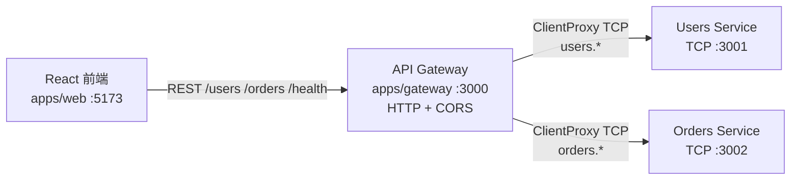
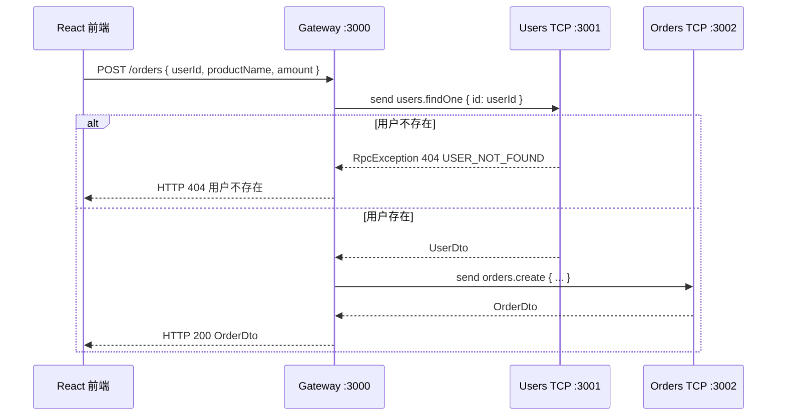

# 架构说明

## 组件关系

## 创建订单时序（含错误路径）

本 Demo 采用 **网关编排**：校验用户在网关完成，订单服务不调用用户服务。

## 消息模式（`packages/shared`）

| Pattern | 方向 | 说明 |
|---------|------|------|
| `users.ping` / `orders.ping` | 网关 → 服务 | 健康探测 |
| `users.findAll` / `users.findOne` / `users.create` | 网关 → 用户服务 | 用户 CRUD（内存） |
| `orders.findAll` / `orders.create` | 网关 → 订单服务 | 订单查询与创建 |

## 为何这样拆？

- **前端只认网关**：浏览器不暴露微服务端口，CORS 与鉴权（后续可加）集中在一处。
- **TCP 微服务**：演示 Nest 微服务传输层；生产可换成 Redis / NATS / Kafka 等，消息模式可复用。
- **共享包**：避免网关与服务各写一份 pattern 字符串，降低拼写错误。
- **错误映射**：微服务抛 `RpcException`，网关 `mapRpcToHttp` 转成 Nest HTTP 异常，前端拿到统一 JSON 错误信息。

## 与「服务间直连」的对比

也可以让订单服务自己注入 Users Client 做校验。本 Demo **刻意**把校验放在网关，优点是：

1. 初学者一眼看出「编排」发生在哪里；
2. 订单服务保持无状态领域操作更简单；
3. 错误路径（404）在 HTTP 层自然表达。

进阶作业：把用户校验下沉到 `orders-service`，网关只做透传，对比两种边界设计。
